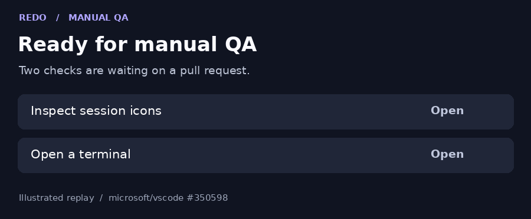

# Redo

[](https://github.com/Unique50101/redo/actions/workflows/test.yml)
[](https://github.com/Unique50101/redo/releases)

[](LICENSE)

**Know which manual checks to repeat after a push.** Redo keeps one checklist comment on a pull request. Each sign-off records the tested commit. When a developer pushes again, Redo compares the new commit with each check’s last sign-off and names the first matching changed path.



## Install

Copy [the example workflow](docs/workflow.yml) to `.github/workflows/redo.yml` on your default branch. Replace its two example checks with manual tests and file globs for your project. Include shared components and dependencies that can affect each check. The action step is:

```yaml
- uses: Unique50101/redo@v1.0.0
  with:
    checks: |
      [{"id":"checkout","label":"Place a test order","paths":["src/checkout/**","src/shared/payments/**"]}]
```

1. Open or update a PR. Each configured check starts **Open**.
2. Test the commit shown in the checklist. Copy the corresponding `/redo pass …` command into a new PR comment. Redo accepts sign-offs from users with repository write access or higher.
3. Push another change. **Passed** means the comparison found no changes to the mapped paths, or the reviewer checked the current commit. **Redo** names a changed path or explains why GitHub could not verify the comparison.

Checks are advisory. A green workflow run means Redo updated the report successfully. A human still performs the manual tests. File rules use Node’s POSIX glob syntax and match repository-relative paths. Each check has a unique ID and includes a rule fingerprint in its command so changing the label or path set requires fresh evidence.

## Public repository replay

We replayed the GitHub comparison for [Microsoft VS Code PR #350598](https://github.com/microsoft/vscode/pull/350598), a fix for recycled session icon colors. We supplied two simulated sign-offs at the merge base and used the public changed paths at head `032b5b8b`.

| Manual check | Result | Evidence |
| --- | --- | --- |
| Inspect session icons | **Redo** | The PR modified `src/vs/workbench/contrib/sessions/browser/views/sessionsListRenderers.ts`. |
| Open a terminal | **Passed** | Neither changed file matched the terminal directory. |

The replay runs in this repository. Microsoft supplied the public change history. The two manual checks and sign-offs are demo inputs. [Inspect the pinned comparison data](test/vscode.json) or [run the replay](test/redo.test.mjs) with Node 24:

```sh
node --test test/*.test.mjs
```

## Permissions and behavior

The example uses the base repository workflow for fork PRs. Redo reads GitHub API metadata and never checks out or executes PR code. Keep the checklist job free of steps that execute PR-controlled code. It needs read access to contents for comparisons and write access to pull requests for its comment. Use the default GitHub Actions token. No external service or AI key is needed.

Deleted and renamed files count, including the old name. If history diverges or a comparison reaches GitHub’s 300-file limit without a match, Redo requests another check. Comparisons use the net change between the signed and current commits. Team-maintained path mappings determine the scope.
